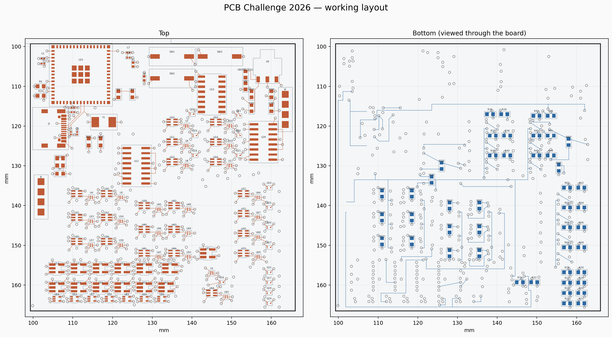

# PCB Challenge 2026

My working layout for the [Fleming Society PCB Challenge](https://github.com/Fleming-Society/PCB-Challenge-2026).

This branch is not ready for submission. There are still **63 unrouted connections**, along with symbol and footprint mismatches to resolve before the final check.

## Current layout

| Item | Result |
| --- | --- |
| Board outline | 66.7 × 67.2 mm |
| Bounding-box area | 4,482.24 mm² |
| Components | 164 |
| Copper layers | Four |
| Board thickness | 1.6 mm |
| Unrouted connections | 63 |
| Other standard DRC errors | 0 |
| DRC warnings | 17 |
| Additional schematic-parity findings | 39 |

The USB, supply, clock and reset routing is in place, together with the local register, synchroniser and comparator connections. The remaining work includes the data buses, pointer connections and enable signals.

The inner layers carry ground and 3V3 pours as well as some signal routes. The control routes on the ground layer stay outside the USB reference area. A separate check of the filled zone found no gaps beneath either main USB trace.

## Opening the project

Open `pcb_challenge_final.kicad_pro` in KiCad 10. The supplied custom footprints are included under `footprints/` and linked through `fp-lib-table`.

The schematic comes from the organisers' corrected files at commit [`8f8f4e2`](https://github.com/Fleming-Society/PCB-Challenge-2026/commit/8f8f4e241fe25e6dbe64b1d4abbda95879012cd6). The layout retains their footprint geometry, including the supplied ESP32 footprint that differs from the installed KiCad library.

## Checks and remaining work

The [DRC report](checks/drc.json) was generated with KiCad 10.0.7. It includes the open connections and the separate schematic-parity findings. The source has inconsistencies around the reset switch, unused symbol pins and USB shield numbering; these still need reviewing. The shield pads are named `SH` in the footprint and `S1` in the symbol.

The [layout audit](checks/layout-audit.json) checks via placement and the USB reference plane. The design rules use a 0.15 mm minimum track width, 0.12 mm clearance, 0.3 mm copper-to-edge clearance and 0.6/0.3 mm vias with a 0.15 mm annular ring.

The logic deduction is kept in the local form notes rather than this public repository. The [submission checklist](SUBMISSION_CHECKLIST.md) records what is still outstanding.
